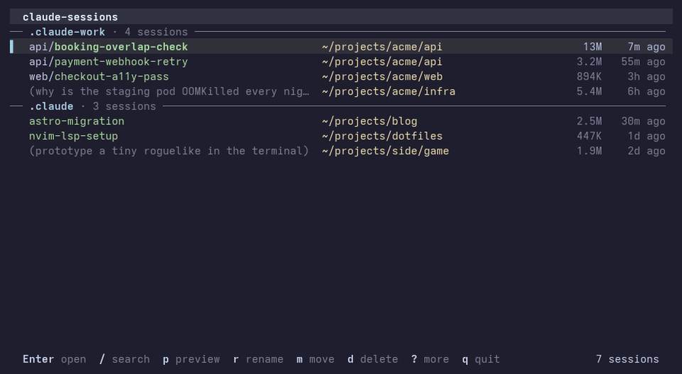

# claude-sessions

A zero-dependency terminal UI for browsing, previewing, resuming, renaming, moving, and deleting [Claude Code](https://claude.ai/code) sessions.



## Features

- **Fast** — reads only the head and tail of each session file and caches the result, so even multi-GB histories load in well under a second
- **Auto-discovers** all `~/.claude*` config directories and `$CLAUDE_CONFIG_DIR` — multiple Claude Code profiles just work
- **Live search** across session titles, first messages and project paths
- **Preview** — press `p` to see the last few messages of the selected session
- **Resume anywhere** — `Enter` opens a new tab in kitty, WezTerm, tmux, iTerm2, Terminal.app or Windows Terminal, and otherwise resumes right in the current terminal (you return to the list when Claude exits). `o` always resumes in place
- **Rename** — press `r`; writes the same record `/rename` does
- **Move** sessions to another profile, an existing folder, or a typed path
- **Delete safely** — sessions go to a trash folder; mark several with `Space` to delete in bulk; `--empty-trash` frees the space
- **Sort** by date, size or name — find the huge sessions eating your disk
- Zero runtime dependencies — pure Node.js stdlib

## Install

```sh
# Global install (recommended)
npm install -g @vinh0809it/claude-sessions

# Or run without installing
npx -y @vinh0809it/claude-sessions
```

Requires Node.js 18+.

## Usage

```sh
claude-sessions                    # Browse all sessions (TUI)
claude-sessions ~/projects/acme    # Filter to a specific folder
claude-sessions --named-only       # Only show /rename'd sessions
claude-sessions --list             # Plain list (pipe-friendly)
claude-sessions --json             # JSON output
claude-sessions -d ~/.claude-work  # Scan a specific config dir
claude-sessions --empty-trash      # Permanently remove deleted sessions
claude-sessions --no-cache         # Ignore the metadata cache
```

Tip: `alias ccs=claude-sessions`

### TUI keys

| Key | Action |
|-----|--------|
| `↑` `↓` / `j` `k` | Navigate |
| `PgUp` `PgDn` | Page up / down |
| `g` / `G` | Jump to top / bottom |
| `/` | Search by title, message or path. While typing: `↑↓` select, `Enter` open, `Tab` keep the filter and go back to the list |
| `Esc` | Clear search and marks |
| `Enter` | Open session (new tab if supported, otherwise here) |
| `o` | Open session in this terminal |
| `p` | Toggle preview of recent messages |
| `r` | Rename session |
| `s` | Cycle sort: date / size / name |
| `Space` | Mark session for bulk delete |
| `n` | New session (choose profile + folder) |
| `m` | Move session to another profile / folder |
| `d` | Move marked (or selected) sessions to trash |
| `?` | Help |
| `q` / `Ctrl-C` | Quit |

## Multiple profiles

Claude Code supports custom config directories via `CLAUDE_CONFIG_DIR`. `claude-sessions` auto-discovers **all** `~/.claude*` directories, so multiple profiles just work:

```sh
# ~/.bashrc or ~/.zshrc
alias claude-main='CLAUDE_CONFIG_DIR=~/.claude-main claude'
alias claude-work='CLAUDE_CONFIG_DIR=~/.claude-work claude'
```

Sessions are grouped by profile in the UI. Press `m` to move a session to a different profile or folder (including a custom typed path). Press `n` to open a new session in any profile and folder.

## Opening sessions

`Enter` opens the session in a new tab when the terminal supports it, and otherwise runs `claude -r <id>` right in the current terminal — when Claude exits you're back in the list.

| Terminal | Support | Notes |
|----------|---------|-------|
| **Kitty** | ✅ new tab | Requires `allow_remote_control yes` in `kitty.conf` |
| **WezTerm** | ✅ new tab | Uses `wezterm cli spawn` |
| **tmux** | ✅ new window | In the current session, also when tmux runs inside kitty or WezTerm |
| **iTerm2** | ✅ new tab | Via `osascript` |
| **Terminal.app** | ✅ new window | Via `osascript` |
| **Windows Terminal** | ✅ new tab | Via `wt new-tab` (native Windows; in WSL it resumes in place) |
| Anything else | ✅ same terminal | GNOME Terminal, Ghostty, VS Code, … |

Set `CLAUDE_SESSIONS_TERMINAL=here` to always resume in place.

Set `NO_COLOR=1` to turn off colors (bold and inverse are kept).

### Custom open command

Set `CLAUDE_SESSIONS_OPEN_CMD` with placeholders `%cmd%`, `%title%`, and `%project%`:

```sh
# Ghostty (or any terminal with a new-tab flag)
export CLAUDE_SESSIONS_OPEN_CMD="ghostty --command=bash -i -c %cmd%"

# iTerm2 via osascript
export CLAUDE_SESSIONS_OPEN_CMD="osascript -e 'tell app \"iTerm\" to create window with default profile command \"bash -i -c %cmd%\"'"

# Force a specific mode: kitty | wezterm | tmux | iterm2 | apple-terminal | windows-terminal | here
export CLAUDE_SESSIONS_TERMINAL=wezterm
```

## How sessions are stored

Claude Code stores sessions in `~/.claude*/projects/<encoded-path>/<uuid>.jsonl`, where `<encoded-path>` is the project path with every non-alphanumeric character replaced by `-`. Each line is a JSON record. `claude-sessions` reads:

- `type: "custom-title"` → the name set by `/rename` (the last one wins)
- First real `type: "user"` message → shown as a fallback title
- `cwd` field → the project path (used for filtering and resuming)

Only the first and last 256 KB of each file are read. Results are cached in `~/.cache/claude-sessions/index.json` (or `$XDG_CACHE_HOME`), keyed by file size and mtime.

Deleted sessions are moved to `<config dir>/.claude-sessions-trash/`; run `claude-sessions --empty-trash` to remove them for good.

> **Renaming a session that is open in Claude Code:** Claude keeps re-writing its own title, so rename it from inside that session with `/rename` instead.

## Contributing

Issues and PRs welcome. Plain Node.js (CommonJS), no dependencies and no build step.

```sh
git clone https://github.com/vinh0809it/claude-sessions
cd claude-sessions
node bin/claude-sessions.js   # run directly
npm link                      # install globally from source
npm test                      # run the test suite (Node built-in test runner)
scripts/demo/record.sh        # re-record docs/demo.gif from fake sessions (needs Pillow + ffmpeg)
```

```
bin/claude-sessions.js   entry point
lib/
  cli.js                 argument handling, --list / --json output
  config.js              usage text, flags, config dir discovery
  sessions.js            reading session files, metadata cache, scanning
  operations.js          move, rename, delete to trash, empty trash
  launch.js              terminal detection, opening sessions
  paths.js               folder-name encoding, path completion
  format.js              dates, sizes, paths for display
  ansi.js                escape sequences and colors
  tui/
    app.js               the full-screen browser
    picker.js            profile → folder → path picker (move, new)
    line-input.js        editable text field
    keys.js              key codes and input splitting
test/                    one file per module
```

## License

[MIT](LICENSE)
